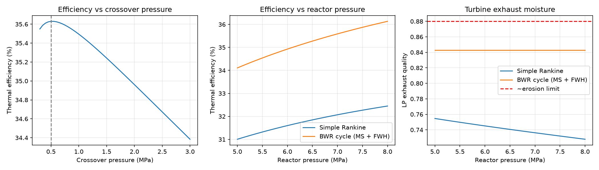

# BWR Power Cycle Model

Python model of a direct-cycle boiling water reactor (BWR) steam cycle, built with IAPWS-IF97 steam tables.

## What it does
- Models two cycles per kg of reactor steam:
  - **Simple Rankine**: reactor steam expands straight to the condenser.
  - **BWR-style cycle**: HP turbine → moisture separator → LP turbine, with separator drains and an HP-exhaust extraction feeding an open feedwater heater.
- Sweeps crossover pressure to find the efficiency optimum.
- Sweeps reactor (steam dome) pressure from 5–8 MPa.
- Scales the result to an 870 MWt reactor, roughly the BWRX-300 thermal rating.

## Results (7.07 MPa reactor, 5 kPa condenser, 85% turbine / 80% pump efficiency)
| | Simple Rankine | BWR cycle |
|---|---|---|
| Thermal efficiency | 32.1% | 35.6% |
| LP exhaust moisture | 26.4% | 15.7% |

- Optimal crossover pressure: ~0.5 MPa
- At 870 MWt: ~304 MWe, ~410 kg/s steam flow



## Limitations / next steps
- LP exhaust moisture (15.7%) is still above the ~12% turbine-erosion guideline; real plants add steam reheat (MSR) and multiple closed feedwater heaters.
- Single open feedwater heater, so feedwater temperature (~153 °C) is lower than in an operating BWR.

## Run
```
pip install iapws numpy matplotlib
python bwr_cycle.py
```
